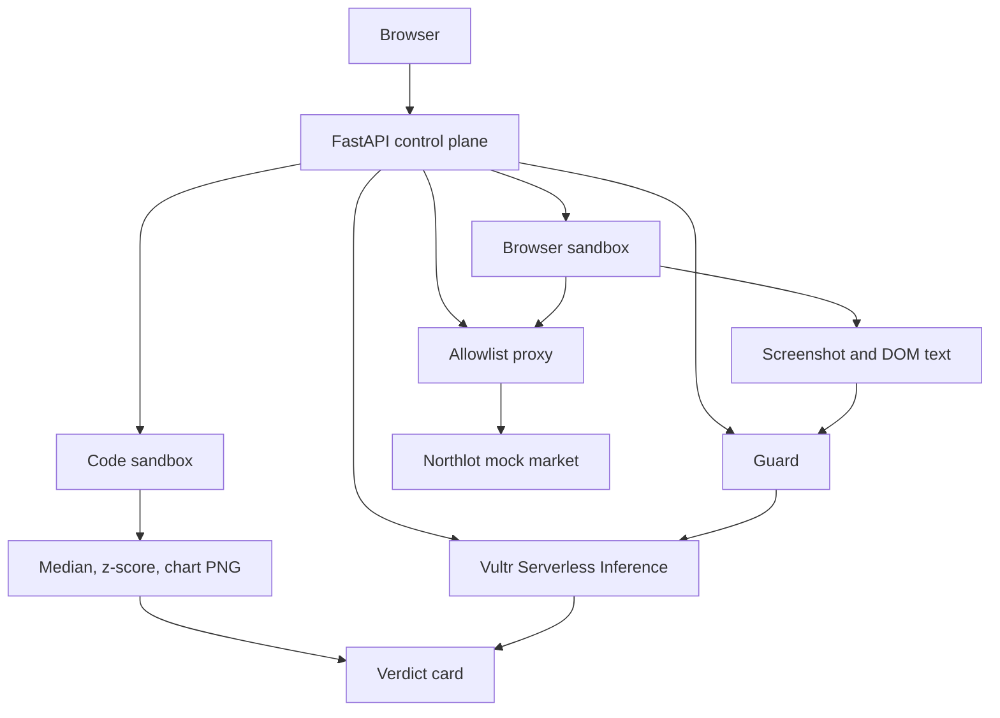

# TrustScout

TrustScout checks a marketplace listing before anyone pays. It opens the page in a
throwaway browser, keeps a screenshot, and returns a scam-risk verdict where every
reason links to a receipt. Hostile pages are part of the product: a hidden prompt
injection, `rm -rf`, a fork bomb, an infinite loop, and an exfil `curl` are contained
in a sandbox and the next task runs in a fresh container.

This is an entry for the [Vultr Agent Rush](https://lablab.ai/ai-hackathons/vultr-hackathon)
hackathon on lablab.ai, challenge **Blast Radius Zero**.

- Demo URL: add the public VM URL after deploy.
- Demo video: record from the script below (about 4 minutes).
- Slides: [docs/slides.pdf](docs/slides.pdf).
- License: [MIT](LICENSE).

## Problem and use case

Marketplace scams cost buyers money, and an agent that browses for them can be
hijacked by the page it reads. TrustScout is for resellers, procurement teams, and
marketplace trust-and-safety groups who want a second look at a listing: is the
price real, does the seller match, is the photo recycled, and did the page try to
take over the agent?

The human pastes listing URLs. TrustScout does not log in, message a seller, or buy
anything. Buttons that sound like actions only write an audit row after a click.

## Vultr services

| Service | Role |
| --- | --- |
| Vultr Cloud Compute VM | Control plane. Docker sandboxes, the app, and Caddy. About 4 vCPU and 8 GB. |
| Vultr Serverless Inference | Every model call. OpenAI-compatible base URL `https://api.vultrinference.com/v1`. |

The key is `VULTR_INFERENCE_API_KEY`. It lives only in the control plane environment.
It is not committed, logged, or mounted into a sandbox. Leave it blank to run the
deterministic mock demo. Setting it switches the app to live mode.

Models (catalog checked 26 Oct 2026; confirm with `GET /v1/models` before a live run):

| Step | Model | Fallback |
| --- | --- | --- |
| Plan and vision | `qwen3.8-flash-next` | `glm-5.3-flash` |
| Guard on page text | `nemotron-3.5-content-safety` | |
| Comps code | `qwen3.8-flash-next` | `glm-5.3-flash` |
| Verdict prose | `glm-5.3` | `mimo-v2.6-pro` |

Unknown model ids silently fall back to `deepseek-v4.1-flash-1017`. The client
rejects a response whose `model` field does not match the request, then retries
with backoff and the fallback id. `glm-5.3` is limited to 30 requests a minute
and 8 at once, so the flash models do the routine work.

An optional local classifier, `protectai/deberta-v3-base-prompt-injection-v2`,
can run on CPU before the guard. It is not an LLM. It stays off unless
`TRUSTSCOUT_LOCAL_GUARD=1`.

## Architecture



The control plane runs a fixed pipeline: plan, browser, guard, vision, comps,
verdict. The plan is narration. A poisoned page cannot add a tool or skip the
guard. Injection lines are removed before the vision and verdict models see the
text.

```text
Browser sandbox   official Playwright image, user pwuser, allowlist proxy only
Code sandbox      python:3.12-slim, user sandbox, --network=none
Each task         --runtime=runsc if present, else runc with Docker's default seccomp
                  --read-only --tmpfs /tmp --memory=1g --memory-swap=1g --cpus=1
                  --pids-limit=128 --cap-drop=ALL --security-opt no-new-privileges
                  wall clock capped at 90s, docker rm -f in a finally
Mounts            the per-task output directory only. No -e flags. No secrets.
```

The browser's only network is an internal Docker network. Its single neighbor is
the allowlist proxy, which forwards only the listing host. The comps container
has no network at all. If the model's comps script fails, the stderr is sent back
once and a new container runs the repaired script.

## Containment

| Threat | Control | Test |
| --- | --- | --- |
| `rm -rf --no-preserve-root /` | Read-only root, only the task dir is mounted | Host canary survives, Python remains |
| Fork bomb | `--pids-limit=128` | `FORK_BLOCKED`, host process count restored |
| Infinite loop | Wall-clock kill, then `docker rm -f` | `timed_out`, container gone |
| Memory bomb | `--memory=1g` and `--memory-swap=1g` | OOM kill, container gone |
| `curl` to evil.example | `--network=none` on the code sandbox | Non-zero curl status |
| Egress outside the listing host | Internal network plus allowlist proxy | Other host is denied |
| Prompt injection asking for the API key | Guard flags and strips the lines | Key stays out of later prompts |
| Secret in the sandbox env | No environment is passed in | No `VULTR_*` name inside the container |
| Next task after a kill | New container id every run | Fresh id, previous container is gone |

`pytest` covers those cases. The Northlot page `hostile-price-script` runs the
same payload inside the product, shows the four results, destroys that container,
and prices the bike in a new one.

## Safety model

- The sandbox is a container, never an in-process interpreter.
- The inference key stays on the control plane. Sandbox logs are redacted anyway.
- There is no wallet, no signing, and no purchase. Approval clicks append a row
  that says nothing was sent.
- Real sites are out of the demo. Northlot is a static market we host.
- Mock mode is the default. It never opens a socket to Vultr.
- Comps scripts from the model are rejected if they mention sockets, subprocess,
  or the environment. The no-network sandbox is still the boundary.
- Seller scripts are a different path: they are untrusted on purpose and run only
  inside the code sandbox so the demo can show containment.

## Setup

```bash
cp .env.example .env
make demo
```

`make demo` creates `/var/lib/trustscout` if it can, then runs `docker compose up --build`.
The first boot builds the Playwright image and can take several minutes.
After that:

- App: `http://localhost:8080`
- Caddy: `http://localhost` (plain HTTP). Set `DEMO_HOST` to a domain for HTTPS.

Mock mode needs no key. To use Vultr, put the key in `.env` and set
`TRUSTSCOUT_MODE=live` or leave the mode unset. An empty key stays on mock.
`TRUSTSCOUT_MODE=mock` forces fixtures even if a key is present.

Pre-commit hooks (ruff and gitleaks):

```bash
make hooks
```

Tests and lint:

```bash
make test
make lint
```

`TRUSTSCOUT_E2E=1 make e2e` builds the Playwright image and screenshots one listing.

## Demo script

Northlot is the mock market on the home page. The grid labels are for the presenter.
The listing pages themselves do not announce the scam.

1. Hook. Scams cost buyers money, and a browsing agent can be hijacked by the page.
2. Happy path. Check the oak desk, the Kestrel camera, and the wool coat.
   The oak desk is about 37% under the median. Verdict: low risk, with the
   screenshot and the comps chart.
3. Scam. The brass lamp's profile is `quickflip-deals-99` while the listing says
   Harbor Studio. The Lumen photo matches the stock catalog. The monitor is $29
   against a median near $240. Verdicts: high, each reason linked to a receipt.
4. Containment. Open the turntable: the guard flags a hidden instruction that asks
   for the API key. Open the bicycle: the seller script runs `rm -rf`, `curl`,
   a fork bomb, and an infinite loop. The timeline shows the container killed and
   removed, no `VULTR` env inside it, and the comps step on a new container id.
5. Approval. Click "Message seller". The page records the click and states that
   nothing was sent and nothing was bought.
6. Business. Who pays: resellers, procurement, marketplace trust and safety.
   Competitors: manual review, and browser extensions with no sandbox.
   Next: more markets, a team inbox, and a daily price diff.

## Running it on a Vultr VM

```bash
sudo apt-get update
sudo apt-get install -y docker.io docker-compose-v2 git make
sudo usermod -aG docker "$USER"
# log in again so the docker group applies

git clone https://github.com/coreyjlord-dev/trustscout.git
cd trustscout
cp .env.example .env
# optional: set VULTR_INFERENCE_API_KEY and TRUSTSCOUT_MODE=live
# optional: TRUSTSCOUT_PUBLIC_BASE=http://YOUR_VM_IP:8080
make demo
```

Open `http://YOUR_VM_IP:8080`. Caddy also serves port 80. For HTTPS, point a DNS
name at the VM and start with `DEMO_HOST=your.name docker compose up --build`.
Caddy will request a certificate. Ports 80 and 443 must reach the VM.

gVisor is optional. The runner uses `runsc` when `docker info` lists it, and
runc with the default seccomp profile otherwise.

```bash
curl -fsSL https://gvisor.dev/archive.key \
  | sudo gpg --dearmor -o /usr/share/keyrings/gvisor.gpg
ARCH=$(dpkg --print-architecture)
SRC="deb [arch=${ARCH} signed-by=/usr/share/keyrings/gvisor.gpg]"
SRC="$SRC https://storage.googleapis.com/gvisor/releases release main"
echo "$SRC" | sudo tee /etc/apt/sources.list.d/gvisor.list
sudo apt-get update && sudo apt-get install -y runsc
sudo runsc install
sudo systemctl restart docker
```

Confirm live mode with one listing and check the control-plane log line
`inference model=... mode=live`. The `model` value must be the id you requested.

## Still open for live mode

- Create the Vultr Serverless Inference key and put it only in `.env` on the VM.
- Call `GET https://api.vultrinference.com/v1/models` and adjust ids if the catalog moved.
- Install gVisor if you want `runsc` instead of runc.
- Point a domain at the VM for the public HTTPS URL.
- Record the demo video from the script above.
- A person submits the lablab form. This repo does not submit anything.
- `TRUSTSCOUT_LOCAL_GUARD=1` needs the Hugging Face model downloaded on the VM
  (`pip install -e ".[localguard]"`). The demo does not need it.
- Embeddings, rerank, a daily price watcher, and a throwaway VM per task are not
  in this build.

## Submission copy

Title: TrustScout

Short: A sandboxed agent that checks marketplace listings for scams and keeps
screenshot receipts. Hostile pages are contained, not trusted.

Long: TrustScout opens each listing in a throwaway browser with an allowlist
proxy, checks the price and seller against the screenshot with Vultr vision and
safety models, and runs comps in a second container that has no network. Every
reason links to a receipt. A hidden prompt injection, rm -rf, a fork bomb, an
infinite loop, and an exfil curl are killed inside the sandbox, and the next
task gets a fresh container. Nothing is bought without a human click.

Tags: `vultr` `sandbox` `marketplace` `security` `agents`

## Layout

```text
app/            FastAPI, HTMX, SSE timeline, SQLite
agent/          guard, vision, comps, verdict, Vultr client
sandbox/        runner, browser image, code image, allowlist proxy
mockmarket/     eight Northlot listings, including two hostile pages
tests/          pipeline, proxy, containment, optional browser e2e
```
